# AI Software Engineering Knowledge Agent

> A production-oriented developer intelligence system that understands software repositories and answers developer questions using source code, documentation, and Git history.

## ✅ IMPLEMENTED — Phases 1 to 8: Foundation, Ingestion, Core RAG, Retrieval Engineering, Git Intelligence, Agentic RAG, Evaluation & Production

**Status: Complete. All 106 tests passing.**

---

## Architecture Overview

```mermaid
graph TB
    subgraph "Phases 1 to 8 — Implemented"
        Client["HTTP Client / Frontend"]
        MW["Middleware (RequestID + RateLimiter)"]
        API["FastAPI Backend (/search, /chat, /git, /agent/query, /evaluate-generation, /tasks)"]
        SVC["Repository Service & RAG Service"]
        DB["PostgreSQL (Alembic Migrations / SQLite for tests)"]
        WORKER["AsyncTaskWorker (Background Ingestion & Jobs)"]
        ING["Ingestion Pipeline"]
        SCAN["Scanner & Ignore Filter"]
        GIT["Git Extractor (Commits, Authors, Diffs)"]
        TS["Tree-sitter Parser (Python/JS/TS)"]
        CHUNK["Semantic Chunker (Code/MD/Config/Git)"]
        EMB["Qwen3 Embeddings (1024-dim)"]
        QD["Qdrant Vector DB (Dense Retrieval)"]
        BM25["BM25 Keyword Engine (Sparse Retrieval)"]
        RRF["Reciprocal Rank Fusion (RRF k=60)"]
        RR["BGE Cross-Encoder Reranker"]
        EVAL["Retrieval Evaluation & Ablation Engine"]
        GEN_EVAL["Generation Evaluation Engine (Faithfulness, Relevance, Recall)"]
        SYN_QA["Synthetic QA Dataset Generator"]
        LLM["Groq LLM (qwen/qwen3.8-27b)"]
        OBS["Langfuse Telemetry & Tracing (Zero-Overhead NoOp Fallback)"]
        AG["LangGraph Multi-Agent Engine"]
        T1["search_code tool"]
        T2["search_docs tool"]
        T3["search_git_history tool"]
        
        Client --> MW
        MW --> API
        API --> SVC
        API --> AG
        API --> GEN_EVAL
        API --> WORKER
        WORKER --> ING
        GEN_EVAL --> SYN_QA
        GEN_EVAL --> RRF
        GEN_EVAL --> LLM
        AG --> T1
        AG --> T2
        AG --> T3
        T1 --> RRF
        T2 --> RRF
        T3 --> BM25
        SVC --> DB
        SVC --> ING
        ING --> SCAN
        ING --> GIT
        SCAN --> TS
        TS --> CHUNK
        GIT --> CHUNK
        CHUNK --> EMB
        CHUNK --> BM25
        EMB --> QD
        QD --> RRF
        BM25 --> RRF
        RRF --> RR
        RR --> EVAL
        RR --> LLM
        LLM --> OBS
        AG --> OBS
        LLM --> AG
        AG --> API
        LLM --> API
    end

    subgraph "Phase 9 — Next"
        UI["Next.js 14 Web Dashboard + Tailwind CSS"]
    end
```



---

## Tech Stack

| Layer | Technology | Status |
|-------|-----------|--------|
| Backend framework | FastAPI + uvicorn | ✅ Phase 1 |
| Database (app metadata) | PostgreSQL + SQLAlchemy 2.0 async | ✅ Phase 1 |
| Configuration | Pydantic Settings v2 | ✅ Phase 1 |
| Logging | structlog | ✅ Phase 1 |
| Testing | pytest + pytest-asyncio + SQLite in-memory | ✅ Phase 1 |
| Repository Loader / Cloner | GitPython (shallow clones) + Local path loader | ✅ Phase 2 |
| File Scanner & Filter | Ignore rules, binary detection, size limits | ✅ Phase 2 |
| AST Code Parsing | tree-sitter ≥0.23 (Python, JS, TS/TSX) | ✅ Phase 2 |
| Semantic Chunking | AST structure, context headers, Markdown & configs | ✅ Phase 2 |
| Embeddings | Qwen3-Embedding-0.6B (1024-dim) | ✅ Phase 3 |
| Vector DB | Qdrant (repo collection isolation) | ✅ Phase 3 |
| LLM Generation | Groq (qwen/qwen3.8-27b) | ✅ Phase 3 |
| Grounded Citations | Line-range source citations `[file#L{start}-L{end}]` | ✅ Phase 3 |
| BM25 Keyword Search | rank-bm25 (BM25Okapi with code tokenizer) | ✅ Phase 4 |
| Hybrid Search | Reciprocal Rank Fusion (RRF, $k=60$) | ✅ Phase 4 |
| Cross-Encoder Reranker | BAAI/bge-reranker-base | ✅ Phase 4 |
| Retrieval Ablation & Metrics | Recall@K, MRR@K, nDCG@K, HitRate@K 4-way ablation | ✅ Phase 4 |
| Git Intelligence | Git history, commit graph, diff search, historical citations | ✅ Phase 5 |
| Agent | LangGraph StateGraph, multi-tool routing, reflection | ✅ Phase 6 |
| LLM Evaluation | Faithfulness, Answer Relevance, Context Recall/Precision, Synthetic QA | ✅ Phase 7 |
| Observability & Production | Langfuse Tracing, Alembic Migrations, Task Worker, Rate Limiter | ✅ Phase 8 |
| Frontend | Next.js 14 + Tailwind | 🔲 Phase 9 |

---

## Project Structure

```
ai-knowledge-agent/
├── backend/
│   ├── api/
│   │   ├── dependencies.py       # FastAPI DI (get_db)
│   │   └── routes/
│   │       ├── health.py         # GET /health
│   │       ├── repositories.py   # Repository CRUD, indexing, /search, /chat, /evaluate-retrieval
│   │       └── git.py            # Git commits, /git/search, /git/file-history
│   ├── agents/                   # 🔲 Phase 6 — LangGraph agent
│   ├── ingestion/                # ✅ Phase 2 & 5 — parsing, chunking, Git extraction
│   │   ├── git_extractor.py      # Git commit log, author, diff extraction & chunking
│   │   ├── scanner.py            # Recursive file discovery & ignore filters
│   │   ├── parsers/              # Tree-sitter AST parsers (Python, JS, TS)
│   │   └── chunkers/             # AST-aligned code chunkers
│   ├── retrieval/                # ✅ Phase 3-4 — vector + BM25 + hybrid
│   │   ├── tokenizer.py          # Code identifier tokenizer (camel/snake/pascal)
│   │   ├── bm25.py               # Per-repository BM25Okapi index
│   │   ├── fusion.py             # Reciprocal Rank Fusion (RRF)
│   │   ├── hybrid.py             # Multi-stage HybridRetriever
│   │   └── eval_retrieval.py     # Retrieval benchmark engine (Recall, MRR, nDCG, HitRate)
│   ├── embeddings/               # ✅ Phase 3 — Qwen3 embeddings (1024-dim)
│   ├── reranking/                # ✅ Phase 4 — BGE cross-encoder reranker
│   ├── llm/                      # ✅ Phase 3 & 5 — Groq integration + Git citations
│   ├── evaluation/               # 🔲 Phase 7 — metrics + experiments
│   ├── config/
│   │   └── settings.py           # Pydantic Settings (all env vars)
│   ├── database/
│   │   ├── models.py             # SQLAlchemy ORM (Repository, IndexingJob)
│   │   ├── connection.py         # Async engine + session factory
│   │   └── crud.py               # DB operations (no business logic)
│   ├── schemas/
│   │   ├── repository.py         # Pydantic request/response models
│   │   └── git.py                # Git commit, search & file-history schemas
│   ├── services/
│   │   └── repository_service.py # Business logic & orchestration
│   ├── tests/
│   │   ├── conftest.py           # SQLite fixtures + DI overrides
│   │   ├── test_health.py        # 7 health tests
│   │   ├── test_repositories.py  # 21 repository API tests
│   │   ├── test_scanner.py       # 5 scanner tests
│   │   ├── test_parsers.py       # 4 AST parser tests
│   │   ├── test_chunkers.py      # 3 chunker tests
│   │   ├── test_ingestion_pipeline.py # 2 ingestion pipeline tests
│   │   ├── test_embeddings.py    # 3 embedding tests
│   │   ├── test_vector_store.py  # 3 Qdrant vector store tests
│   │   ├── test_llm.py           # 3 LLM service & citation tests
│   │   ├── test_rag.py           # 3 RAG integration tests
│   │   ├── test_tokenizer.py     # 4 tokenizer tests
│   │   ├── test_bm25.py          # 2 BM25 tests
│   │   ├── test_fusion.py        # 2 RRF fusion tests
│   │   ├── test_reranker.py      # 2 reranker tests
│   │   ├── test_hybrid_retrieval.py # 1 hybrid retriever test
│   │   ├── test_retrieval_eval.py # 2 retrieval ablation tests
│   │   ├── test_git_extractor.py # 4 Git extractor unit tests
│   │   └── test_git_rag.py       # 1 Git intelligence end-to-end test
│   ├── main.py                   # FastAPI app + lifespan
│   └── requirements.txt
├── docker/
│   └── docker-compose.yml        # PostgreSQL + Qdrant
├── .env.example                  # All environment variable templates
├── pyproject.toml                # pytest configuration
└── README.md
```

---

## Quick Start

### 1. Set Up Environment

```bash
cd ai-knowledge-agent
python -m venv .venv
.venv\Scripts\activate          # Windows
# source .venv/bin/activate     # Linux/Mac

pip install -r backend/requirements.txt
```

### 2. Configure Environment

```bash
copy .env.example .env
# Edit .env — at minimum set SECRET_KEY and DATABASE_URL
```

### 3. Start Infrastructure (PostgreSQL + Qdrant)

```bash
docker compose -f docker/docker-compose.yml up -d
```

### 4. Run the Backend

```bash
cd ai-knowledge-agent
.venv\Scripts\python -m uvicorn backend.main:app --reload
# API docs: http://localhost:8000/docs
# Health:   http://localhost:8000/health
```

### 5. Run Tests (no PostgreSQL needed)

```bash
.venv\Scripts\python -m pytest backend/tests/ -v
# 106 passed in ~2.8s
```

---

## API Endpoints

| Method | Endpoint | Description |
|--------|----------|-------------|
| `GET` | `/health` | Health check + DB connectivity |
| `POST` | `/api/v1/repositories` | Register a new repository |
| `GET` | `/api/v1/repositories` | List repositories (paginated) |
| `GET` | `/api/v1/repositories/{id}` | Get repository by ID |
| `DELETE` | `/api/v1/repositories/{id}` | Delete repository & vector collection |
| `POST` | `/api/v1/repositories/{id}/index` | Trigger indexing job (source code, docs & Git history) |
| `GET` | `/api/v1/repositories/{id}/status` | Get latest indexing job status |
| `POST` | `/api/v1/repositories/{id}/search` | Semantic code & doc search with filters & retrieval mode |
| `POST` | `/api/v1/repositories/{id}/chat` | Grounded Q&A with code and Git commit citations |
| `POST` | `/api/v1/repositories/{id}/evaluate-retrieval` | 4-way retrieval ablation benchmark (Recall@K, MRR@K, nDCG@K, HitRate@K) |
| `GET` | `/api/v1/repositories/{id}/git/commits` | Paginated list of ingested Git commits and diff summaries |
| `POST` | `/api/v1/repositories/{id}/git/search` | Search Git history by message, author, diff keywords or semantic meaning |
| `POST` | `/api/v1/repositories/{id}/git/file-history` | Retrieve full commit audit trail and evolution of a specific file |
| `POST` | `/api/v1/repositories/{id}/agent/query` | Autonomous LangGraph agent with tool routing, reflection & self-correction |
| `POST` | `/api/v1/repositories/{id}/evaluate-generation` | Automated generation quality evaluation (Faithfulness, Relevance, Recall, Precision, Hallucination) |
| `GET` | `/api/v1/tasks` | List recent background worker jobs and execution statuses |
| `GET` | `/api/v1/tasks/{task_id}` | Retrieve status and error logs for an asynchronous task ID |

---

## Key Design Decisions

### UUID Strategy
Uses a `TypeDecorator` that dispatches to PostgreSQL native UUID in production and CHAR(36) in SQLite during tests. Same ORM models, zero test infrastructure friction.

### Layer Separation
- **CRUD** (`database/crud.py`): pure DB operations, no business rules, no commits
- **Service** (`services/`): `RepositoryService` and `RAGService` encapsulate business logic and orchestration
- **Route** (`api/routes/`): HTTP only — parse input, call service, map exceptions to status codes

### Test Isolation
Each test gets a fresh in-memory SQLite database (engine `scope="function"`) and shared in-memory vector mock. Runs completely offline in <3s.

---

## Development Phases

| Phase | Status | Description |
|-------|--------|-------------|
| **1 — Foundation** | ✅ **Complete** | FastAPI, DB models, Repository CRUD, 28 tests |
| **2 — Ingestion** | ✅ **Complete** | Tree-sitter AST parsing, semantic chunking, 42 tests |
| **3 — RAG** | ✅ **Complete** | Qwen3 embeddings, Qdrant store, Groq generation, search/chat, 54 tests |
| **4 — Retrieval** | ✅ **Complete** | BM25 keyword search, hybrid RRF, BGE reranking, ablation engine, 68 tests |
| **5 — Git Intel** | ✅ **Complete** | Commit ingestion, diffs, Git-aware search, historical RAG, 73 tests |
| **6 — Agent** | ✅ **Complete** | LangGraph multi-agent, code/docs/git tools, query routing, reflection, 89 tests |
| **7 — Evaluation** | ✅ **Complete** | Faithfulness, Answer Relevance, Context Recall/Precision, Synthetic QA, 98 tests |
| **8 — Production** | ✅ **Complete** | Docker, Alembic, Langfuse Tracing, Task Worker, Rate Limiting, 106 tests |
| **9 — Frontend** | 🔲 Next | Next.js chat UI, citations, eval dashboard |
